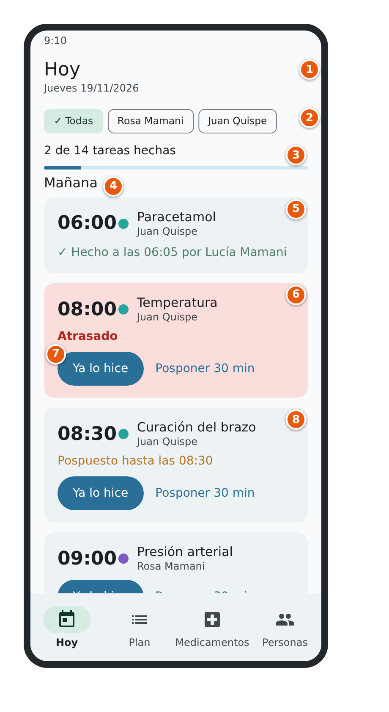

# Sistema de Cuidados — Equipo 5

**Proyecto académico · Programación III · Aplicación Android**

## Descripción

Sistema de Cuidados es una aplicación móvil desarrollada por el **Equipo 5** para apoyar la organización de actividades de cuidado de personas en el hogar. El proyecto reúne información de personas cuidadas, cuidadores, planes de cuidado, rutinas, mediciones, seguimientos y medicamentos.

> **Estado del proyecto: en desarrollo.** No todas las funciones están integradas en la rama `main`; algunos módulos se encuentran en ramas y Pull Requests pendientes de revisión.

## Objetivo

Organizar las tareas de cuidado, visualizar quién necesita atención y facilitar el seguimiento de actividades programadas, aplicando conceptos de **programación orientada a objetos**, como clases, herencia, asociaciones y polimorfismo.

## Tecnologías utilizadas

- **Kotlin** como lenguaje de programación.
- **Android Studio** como entorno de desarrollo.
- **Jetpack Compose y Material 3** para la interfaz.
- **Gradle con Kotlin DSL** para la construcción del proyecto.
- **Android 8.0 (API 26)** como versión mínima configurada.

## Módulos del sistema

| Área | Pantalla | Funcionalidades | Estado |
| --- | --- | --- | --- |
| **1. Personas** | `PersonasScreen` | Consulta de personas cuidadas y cuidadores, roles, notas y contactos; botón para abrir el marcador telefónico. | Disponible en `main` con datos de ejemplo. |
| **2. Plan de cuidados** | `PlanScreen` | Planes por persona, rutinas, mediciones, seguimientos, filtros y tarjetas con detalles desplegables. | Disponible en `main` con datos de ejemplo. |
| **3. Medicamentos** | `MedicamentosScreen` | Gestión visual de medicamentos, avisos e inventario. | En desarrollo, en el [Pull Request #2](https://github.com/gummyzzz/equipo-5-proyecto-prograiii/pull/2); aún no integrado en `main`. |
| **4. Hoy** | `HoyScreen` | Agenda diaria, filtros por persona, avance, franjas horarias, tareas realizadas, omitidas o pospuestas y validación de mediciones. | En desarrollo, en el [Pull Request #3](https://github.com/gummyzzz/equipo-5-proyecto-prograiii/pull/3); aún no integrado en `main`. |

La navegación principal tiene cuatro pestañas: **Hoy, Plan, Medicamentos y Personas**. En la rama `main`, las pantallas Hoy y Medicamentos aún son provisionales.

## Diagrama de clases

Se conserva el diagrama UML del proyecto utilizado como referencia para las entidades, sus atributos, métodos y relaciones.

### Conceptos de POO aplicados

- **Clases y objetos:** `Persona`, `Cuidador`, `PersonaCuidada`, `PlanCuidado` y `RegistroActividad`, entre otros.
- **Abstracción y herencia:** `Habito` se define como clase sellada y se especializa en rutinas, mediciones y seguimientos.
- **Polimorfismo:** los distintos hábitos implementan comportamientos como `tipo()` y `aceptaValor()`.
- **Relaciones entre clases:** cada evento de agenda se asocia con una persona, un hábito y, cuando corresponde, un registro.

## Diseño de interfaces

Los documentos de diseño están en [`docs/diseno/`](docs/diseno/).

**Boceto del Área 4 — Hoy** (incluido en la rama `modulo-agenda`):



*Este es un boceto de referencia, no una captura de la aplicación terminada.*

## Organización del proyecto

```text
equipo-5-proyecto-prograiii/
├── app/
│   └── src/main/
│       ├── java/com/example/equipo5cuidados/
│       │   ├── data/          # Datos y generadores de ejemplo
│       │   ├── model/         # Clases y reglas del dominio
│       │   ├── navigation/    # Destinos de navegación
│       │   ├── ui/            # Pantallas y tema visual
│       │   └── MainActivity.kt
│       └── res/               # Recursos de Android
├── docs/
│   ├── Diagrama_Clases_Momento1.png
│   └── diseno/                # Diseños y bocetos
├── gradle/
└── README.md
```

Las carpetas anteriores describen la estructura general. Algunos archivos nuevos están disponibles únicamente en sus respectivas ramas mientras se revisan los Pull Requests.

## Cómo abrir y ejecutar la aplicación

1. Instalar **Android Studio** y configurar el SDK de Android correspondiente.
2. Clonar el repositorio:

   ```bash
   git clone https://github.com/gummyzzz/equipo-5-proyecto-prograiii.git
   ```

3. Abrir la carpeta descargada en Android Studio.
4. Sincronizar el proyecto con Gradle.
5. Seleccionar un emulador o dispositivo Android compatible y pulsar **Run**.

Para probar un módulo todavía no fusionado, seleccionar su rama correspondiente en Git. Su funcionamiento conjunto con otras ramas requiere integración y pruebas adicionales.

## Estado actual y pendientes

- La información de personas y planes se obtiene de **datos de prueba en memoria**.
- La rama `modulo-agenda` genera actualmente **8 actividades de hábitos** para el día; la guía del área prevé **14 eventos** al integrar también los medicamentos y sus datos de prueba acordados.
- Falta completar la integración entre **Hoy** y **Medicamentos** y verificar la correspondencia de los datos de ambas áreas.
- Hay funciones de creación y persistencia de información que siguen pendientes.
- Es necesario realizar pruebas de integración antes de considerar terminada la aplicación.

## Trabajo colaborativo

Cada integrante desarrolla su módulo en una rama, utiliza commits descriptivos y solicita revisión mediante un **Pull Request** antes de integrar los cambios a `main`.

**Repositorio:** [equipo-5-proyecto-prograiii](https://github.com/gummyzzz/equipo-5-proyecto-prograiii)

---

**Proyecto con fines académicos.** La aplicación no sustituye la orientación de profesionales de la salud.


