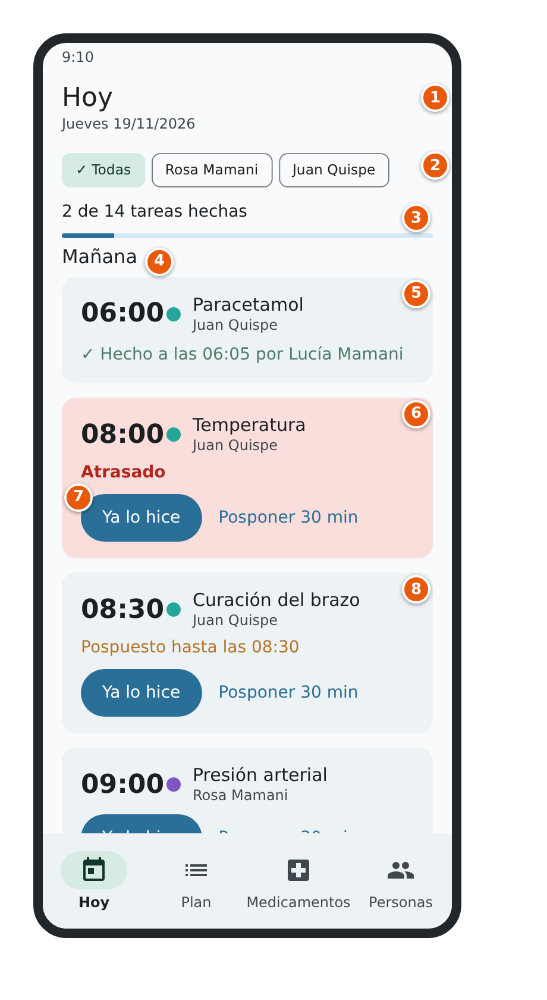

# Diseño de interfaz · Área 4: Hoy (`HoyScreen`)

## Proyecto

Sistema de cuidados · Programación III · Equipo 5

- **Área:** 4 · Hoy
- **Rama:** `modulo-agenda`
- **Pantalla:** `HoyScreen` en `ui.agenda`

## Objetivo

La pantalla Hoy es la pantalla principal: lo primero que ve el cuidador. Muestra todo lo que toca hoy, ordenado por hora y agrupado en **Mañana**, **Tarde** y **Noche**, con una barra de avance del día.

Cada tarea se puede marcar como hecha, posponer o marcar como no hecha. Una tarea **no se puede registrar dos veces**.

## Boceto de la guía

## Partes obligatorias del boceto

1. **Barra superior:** «Hoy» y la fecha.
2. **Chips:** «Todas» o una persona cuidada.
3. **Avance:** «X de Y tareas hechas» y una barra.
4. **Franjas:** Mañana (antes de las 12), Tarde (12 a 19) y Noche (desde las 19). Solo se muestran si tienen tareas.
5. **Tarea hecha:** «✓ Hecho a las HH:mm por Nombre», en color `secondary` y sin botones.
6. **Tarea atrasada:** pasaron más de 30 minutos; fondo `errorContainer` y texto «Atrasado».
7. **Acciones:** «Ya lo hice», «Posponer 30 min» y «No se hizo».
8. **Tarea pospuesta:** muestra la hora nueva y «Pospuesto hasta las HH:mm» en color `tertiary`.

## Diálogo «Ya lo hice»

- Título: nombre de la tarea.
- **Medición:** campo «Valor en <unidad>».
- **Seguimiento:** campo con su pregunta; para sí/no se escribe «sí» o «no».
- Validación: si `aceptaValor` devuelve falso, mostrar «El valor no es válido para este registro» y no guardar.
- Botones: «Cancelar» y «Guardar».
- **Medicamento con aviso previo:** casilla con el texto del aviso; si no se confirma, mostrar «Confirme el aviso antes de registrar».
- **Rutinas y medicamentos sin aviso:** registro directo, sin diálogo.

## Componentes de Jetpack Compose previstos

- `Scaffold` y `TopAppBar` para la estructura de la pantalla.
- `FilterChip` para la selección de personas.
- `LinearProgressIndicator` para el avance diario.
- `LazyColumn` para la lista de eventos.
- `Card`, `Row`, `Column` y `Text` para cada tarjeta.
- `Button` y `TextButton` para las acciones.
- `AlertDialog` para mediciones, seguimientos y avisos previos.

## Modelo e integración

**Clases de tu área (en `model`):** `EventoAgenda`, `RegistroActividad`, `EstadoEvento`, `ResultadoRegistro` y `OrigenRegistro`.

**Generador (en `data`):** `DatosAgenda.generarHoy(): List<EventoAgenda>`.

**Dependencias:** `DatosPersonas`, `DatosHabitos`, `Programacion`, `Habito`, `ValorRegistrado`, `DatosMedicamentos` y `HabitoMedicamento`. Se usan desde otras áreas, sin modificarlas.

**Reglas de prueba establecidas por la guía:** eventos del día ordenados por hora prevista; tolerancia de 30 minutos; posposición de 30 minutos; cuidadora actual Lucía Mamani (`id = 3`); origen `CUIDADOR`. El caso de ejemplo registra el primer evento a las 06:05. La guía espera 14 eventos al integrar los datos de todas las áreas.

## Estilo compartido

Se usan los colores de `MaterialTheme.colorScheme`, la tipografía de `MaterialTheme.typography` y las medidas establecidas por el equipo: margen lateral `16.dp`, separación entre tarjetas `12.dp`, relleno de tarjeta `16.dp` y espacio entre chips `8.dp`. No se crea otra barra inferior porque el menú principal ya existe.

## Estado del módulo

Documento de diseño. Implementación pendiente; se realizará en la rama `modulo-agenda`, sin cambiar `MainActivity.kt` ni los archivos de otras áreas.
