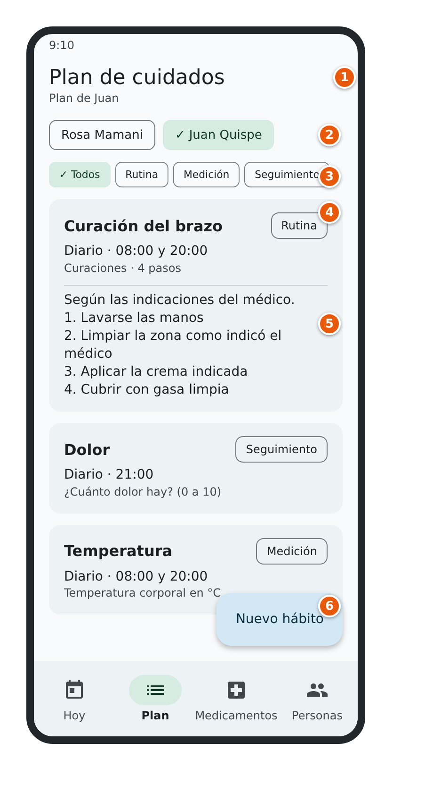

# Pantalla Plan (área 2)



## Objetivo
Mostrar el plan de cuidados de una persona: rutinas, mediciones y seguimientos.
Objetos que lista: `PlanCuidado`, `Habito` (y sus subclases `HabitoRutina`, `HabitoMedicion`, `HabitoSeguimiento`), `Programacion`, `PasoRutina`.

## Boceto
```
┌──────────────────────────────────────┐
│ Plan de cuidados                     │  TopAppBar
│ Plan de Juan                         │
├──────────────────────────────────────┤
│ [Rosa Mamani] [Juan Quispe]          │  SelectorPersona (FilterChip)
│ [Todos] [Rutina] [Medición] [Seguim.]│  FiltroTipo (FilterChip)
├──────────────────────────────────────┤
│ ┌──────────────────────────────────┐ │  LazyColumn
│ │ Curación del brazo     (Rutina)  │ │  Card + AssistChip
│ │ Diario · 08:00 y 20:00           │ │  Programacion.descripcion()
│ │ Curaciones · 4 pasos             │ │
│ │ ── al tocar se despliega ──      │ │  AnimatedVisibility
│ │ 1. Lavarse las manos             │ │  pasosOrdenados()
│ │ 2. Limpiar la zona ...           │ │
│ └──────────────────────────────────┘ │
│ ┌──────────────────────────────────┐ │
│ │ Temperatura          (Medición)  │ │
│ │ Valores aceptados: 34 a 43 °C    │ │
│ └──────────────────────────────────┘ │
│                    [ Nuevo hábito ]  │  ExtendedFloatingActionButton (TODO)
└──────────────────────────────────────┘
```

## Conceptos de POO que se ven en esta pantalla
- **Clase abstracta:** `Habito` (en Kotlin, `sealed class`).
- **Herencia:** las 4 subclases heredan de `Habito`.
- **Polimorfismo:** `tipo()` y `aceptaValor()` responden distinto según la subclase; la tarjeta usa `when (habito) { is HabitoRutina -> ... }`.

## Archivos
| Archivo | Contenido |
|---|---|
| `model/Programacion.kt` | Frecuencia, Programacion, PasoRutina |
| `model/Habito.kt` | TipoHabito, FormatoEntrada, Habito y 3 subclases |
| `model/ValorRegistrado.kt` | Lo necesita `aceptaValor()` |
| `model/PlanCuidado.kt` | PlanCuidado |
| `data/DatosHabitos.kt` | Planes de Rosa y de Juan |
| `ui/habitos/HabitoComponentes.kt` | SelectorPersona, FiltroTipo, HabitoCard |
| `ui/habitos/PlanScreen.kt` | Pantalla |

## Commits sugeridos (rama `modulo-habitos`)
1. `Agrega programación y pasos de rutina` → Programacion.kt
2. `Agrega jerarquía de hábitos con clase abstracta` → Habito.kt + ValorRegistrado.kt (**día 1**: medicamentos hereda de aquí)
3. `Agrega plan de cuidados` → PlanCuidado.kt
4. `Agrega datos de prueba del plan` → DatosHabitos.kt
5. `Agrega diseño de la pantalla Plan` → este archivo
6. `Agrega tarjeta de hábito con detalle desplegable` → HabitoComponentes.kt
7. `Agrega pantalla Plan con filtros` → PlanScreen.kt
8. `Agrega prompts usados en la pantalla Plan`

## Nota
Al compilar sale un *warning* en `PlanCuidado.desactivar`: «'else' is redundant». Es normal mientras no exista `HabitoMedicamento`; cuando el área 3 lo suba, cambia el `else` por `is HabitoMedicamento -> h.copy(activo = false)`.
